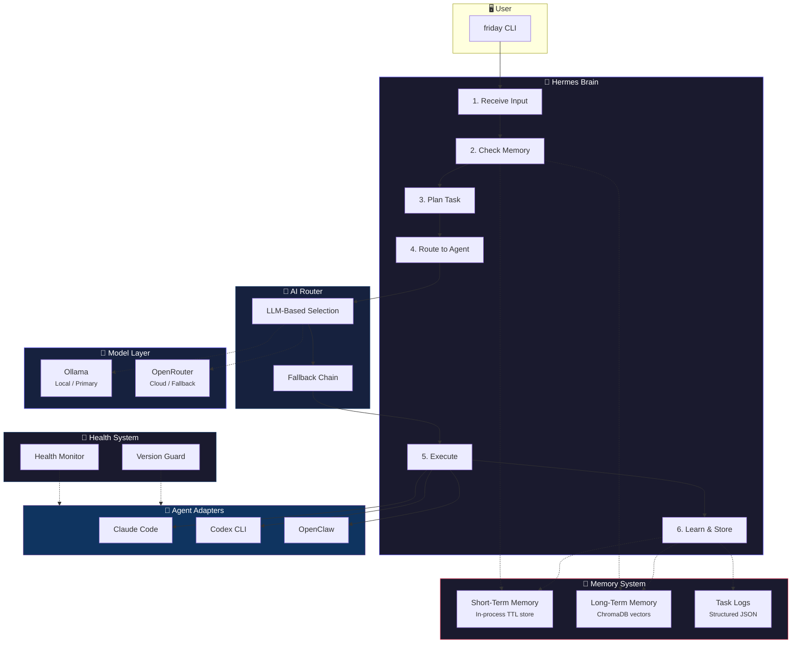
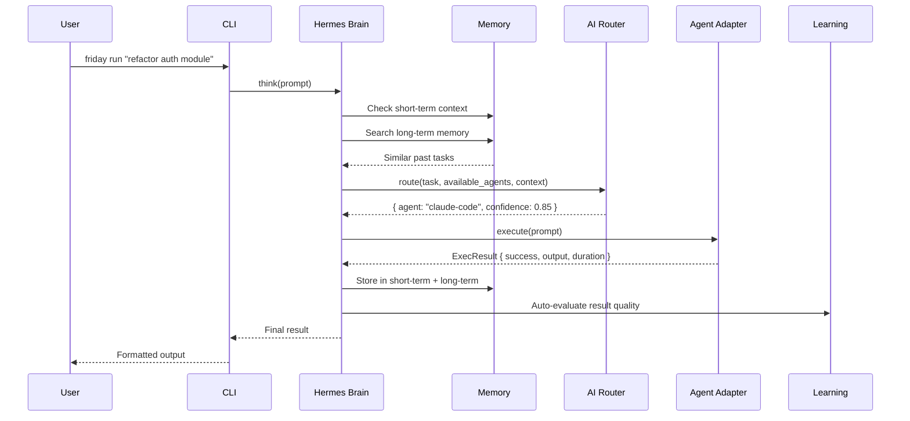

<p align="center">
  <strong>🧠 Friday</strong><br>
  <em>A local-first, Jarvis-style personal assistant: appointments, reminders, todos,
  daily automations, and AI coding agents</em>
</p>

<p align="center">
  <a href="#install"></a>
  <a href="LICENSE"></a>
  <a href="#features"></a>
  <a href="#ollama-setup"></a>
</p>

---

Friday is a **personal assistant that runs on your own computer**. Tell it what you need in
plain language and it books appointments (refusing double-bookings), sets reminders, keeps
your to-do list, sends you a daily briefing, and runs recurring automations in the
background. Anything that needs real work on code or your computer is handed to an AI agent.

```bash
friday ask "book dentist friday 3pm for 45 minutes at Smile Clinic"
friday ask "remind me to call mom tomorrow at 6pm"
friday ask "every weekday at 8am brief me"
friday ask "every monday at 10am summarize my open GitHub PRs"   # runs through an AI agent
friday agenda tomorrow
friday daemon install    # start the background assistant at log-on (Windows)
```

Under the hood, Friday is also a **terminal orchestrator** for AI coding agents. One CLI
routes any task to the best available agent — Claude Code, Codex CLI, or OpenClaw —
using LLM-powered intelligent routing. Every execution is stored in short-term memory,
long-term ChromaDB semantic memory, and structured JSON task logs, enabling the system
to learn and improve over time.

Friday runs entirely on your machine. The default Ollama models are lightweight and free:

| Role | Default Model | Purpose |
|------|--------------|---------|
| 🧠 Brain | `qwen3:4b` | Planning, routing, and orchestration decisions |
| ⚡ Fast | `qwen2.5-coder:3b` | Quick coding-oriented evaluations |

> **No API keys required.** Friday works out of the box with Ollama.
> Optional cloud fallback via OpenRouter is available for when you need larger models.

---

## Table of Contents

- [Personal Assistant](#personal-assistant)
- [Architecture](#architecture)
- [Features](#features)
- [Quick Start](#quick-start)
- [Installation](#installation)
- [Ollama Setup](#ollama-setup)
- [Agent CLIs](#agent-clis)
- [CLI Reference](#cli-reference)
- [Configuration](#configuration)
- [Project Layout](#project-layout)
- [How It Works](#how-it-works)
- [Troubleshooting](#troubleshooting)
- [Development](#development)
- [Roadmap](#roadmap)
- [Contributing](#contributing)
- [License](#license)

---

## Personal Assistant

Everything is stored in a local SQLite database (`<runtime home>/data/assistant.db`); nothing
leaves your machine unless an automation asks an AI agent to do something.

### Talk to it: `friday ask`

`friday ask "<anything>"` understands requests with built-in rules first (offline and
predictable), then the local Ollama model for unusual phrasing. Requests that aren't
assistant actions are run as agent tasks, like `friday run`. Use `--dry-run` to see how a
request was understood without doing it, and `--no-llm` to use rules only.

| Say | Friday does |
|-----|-------------|
| `book dentist friday 3pm for 45 minutes at Smile Clinic` | books it, checks for clashes, sets a reminder 15 min before |
| `schedule a meeting with Rahul next monday at 11am` | books "Meeting with Rahul" |
| `remind me to call mom tomorrow at 6pm` | one-off reminder |
| `remind me to drink water every 2 hours` | repeating reminder |
| `todo: finish the report by friday` | adds a todo with a due date |
| `what's on my agenda tomorrow` | shows the day's briefing |
| `every weekday at 8am brief me` | daily briefing automation |
| `every day at 9pm remind me to journal` | recurring notification |
| `every monday at 10am summarize my github notifications` | recurring AI agent task |

Times understood: `in 20 minutes`, `in 2 hours`, `tomorrow 3pm`, `tonight`, `friday 10am`,
`next monday at 9`, `14 oct 3pm`, `2026-10-14 14:00`, `noon`. A bare `at 2` … `at 7` means
afternoon. Dates without a time default to 09:00.

### Direct commands

```bash
friday schedule "Dentist" --at "friday 3pm" --for 45m --where "Smile Clinic" [--remind 30] [--force]
friday agenda [tomorrow|friday|2026-10-14]     # appointments, reminders, todos, next free hour
friday free 2h [--after "monday 9am"]           # next free slot in working hours
friday cancel <appointment-#>

friday todo add "Buy milk" [--due friday] [--high|--low]
friday todo list [--all] | friday todo done <#> | friday todo rm <#>

friday remind add "Stretch" --at "in 30 minutes" [--repeat "every 2 hours"]
friday remind list | friday remind rm <#>

friday automate add "every weekday at 8am" --brief
friday automate add "every day at 9pm" --notify "Journal for 5 minutes"
friday automate add "every monday at 10am" --task "summarize my open GitHub PRs"
friday automate list | pause <#> | resume <#> | run <#> | rm <#>

friday calendar export friday.ics               # import into Google/Outlook/Apple Calendar
```

### The background daemon

Reminders and automations need Friday running in the background:

```bash
friday daemon run          # foreground; Ctrl+C to stop
friday daemon install      # Windows: start automatically at log-on (Task Scheduler)
friday daemon uninstall
```

On macOS/Linux, `friday daemon install` prints a launchd/systemd unit to add. Each
reminder is delivered exactly once as a desktop notification (Windows toast, macOS
Notification Center, Linux `notify-send`) and logged to `data/notifications.log`. If the
computer was off, overdue reminders are delivered on the next start with the time they were
due, and each missed automation runs once (not once per missed occurrence). Daily briefings
are also saved to `data/briefings/`.

Agent-task automations run through Hermes exactly like `friday run`, with the agent's normal
permissions (see [Agent CLIs](#agent-clis)), so they cannot edit files unless you allowed that.

### Assistant settings (`friday.yaml`)

```yaml
assistant:
  db_path: ./data/assistant.db
  default_duration_minutes: 30
  remind_before_minutes: 15
  workday_start: "09:00"
  workday_end: "18:00"
```

### Calendar sync

Appointments live in Friday's own calendar today and can be exported as `.ics`. Two-way sync
with an online calendar (Google Calendar or Outlook) is not built yet.

---

## Architecture

Friday Hub follows a layered architecture with **Hermes** as the central brain.
Every task flows through the same pipeline regardless of which agent handles it:



### Data Flow



---

## Features

### 🧠 Hermes Brain
The central orchestrator. Every task flows through Hermes, which manages the full lifecycle:
receive input → check memory → plan → route → execute → learn → return. Hermes ensures
consistent behavior regardless of which agent handles the work.

### 🔀 AI-Powered Router
Instead of hardcoded keyword matching, Friday uses an LLM to intelligently select the best
agent for each task. The router considers agent capabilities, past performance from memory,
and task characteristics to make informed routing decisions with confidence scores.

### 🤖 Agent Adapters
A unified interface wraps each supported CLI tool. Adding a new agent is as simple as
creating a thin adapter class — the base class handles detection, health checks, execution,
timeouts, and error handling automatically.

| Agent | Best For | Capabilities |
|-------|----------|-------------|
| **Claude Code** | Deep understanding, architecture, multi-file edits | `code-refactoring`, `debugging`, `architecture` |
| **Codex CLI** | Fast coding, test generation, routine tasks | `fast-coding`, `test-generation`, `sandboxed-execution` |
| **OpenClaw** | Automation, multi-platform, web tasks | `automation`, `messaging`, `web-automation` |

### 💾 Dual Memory System
- **Short-Term Memory**: In-process key-value store with TTL-based expiry. Holds the current
  conversation, active task state, and recent results. No external dependencies.
- **Long-Term Memory**: ChromaDB vector database for persistent semantic search. Find similar
  past tasks, learn from previous executions, and improve routing over time.

### 📋 Structured Task Logs
Every execution produces a detailed JSON log with task ID, timestamp, routing decision,
agent used, output, duration, and feedback. Useful for debugging, auditing, and analytics.

### 🏥 Health Monitor & Version Guard
- **Health Monitor**: Detects installed agents, checks health, and reports status.
- **Version Guard**: Tracks agent CLI versions in a lock file. When a version changes,
  runs a smoke test — if it passes, the new version is accepted; if it fails, tasks
  automatically fall back to another agent.

### 📊 Self-Improving Feedback Loop
After each task, the learning module auto-evaluates result quality and stores feedback.
Future routing decisions use this history to improve agent selection. Users can also
provide manual thumbs-up/thumbs-down feedback.

### 🔍 Project Context Awareness
The context module scans the working directory to detect project type, git status, file
structure, and frameworks. This context enriches the prompts sent to agents, producing
more relevant results.

---

## Quick Start

```bash
# 1. Install Friday Hub
pip install git+https://github.com/<your-username>/friday-hub.git

# 2. Start Ollama and pull models
ollama serve
ollama pull qwen3:4b
ollama pull qwen2.5-coder:3b

# 3. Install at least one agent CLI
npm i -g @anthropic-ai/claude-code

# 4. Run your first task
friday run "explain how the auth middleware works"
```

---

## Installation

### From GitHub

```bash
pip install git+https://github.com/<your-username>/friday-hub.git
```

### From Source (Development)

```bash
git clone https://github.com/<your-username>/friday-hub.git
cd friday-hub
python -m venv .venv
```

**Windows:**
```bash
.venv\Scripts\activate
pip install -e ".[dev]"
copy .env.example .env
```

**macOS / Linux:**
```bash
source .venv/bin/activate
pip install -e ".[dev]"
cp .env.example .env
```

After installation, the `friday` command is available globally in your terminal.

---

## Ollama Setup

[Ollama](https://ollama.ai) provides free, local LLM inference. Install it, then:

```bash
# Start the Ollama server
ollama serve

# Pull the default models (~2-4 GB total)
ollama pull qwen3:4b          # Brain model — planning & routing
ollama pull qwen2.5-coder:3b  # Fast model — quick evaluations
```

### Cloud Fallback (Optional)

If Ollama is unavailable, Friday can fall back to [OpenRouter](https://openrouter.ai)
for cloud-based inference. Set your API key in `.env`:

```bash
OPENROUTER_API_KEY=sk-or-...your-key-here
```

Friday always tries Ollama first. Cloud is only used when local inference fails.

---

## Agent CLIs

Install at least one supported agent CLI. Friday auto-detects what's available on `PATH`:

```bash
# Claude Code (Anthropic) — recommended
npm i -g @anthropic-ai/claude-code

# Codex CLI (OpenAI)
npm i -g @openai/codex

# OpenClaw (needs its Gateway running; see `openclaw onboard`)
npm i -g openclaw@latest
```

How Friday calls each agent (non-interactively, without a shell):

| Agent | Command | Prompt delivery |
|-------|---------|-----------------|
| Claude Code | `claude -p` | stdin |
| Codex CLI | `codex exec -` | stdin (Codex requires a git repository by default) |
| OpenClaw | `openclaw agent --agent main --message-file <tmp>` | temp file |

> **Permissions:** in `-p` mode Claude Code only uses tools you have pre-approved, so by
> default it answers and plans but does not edit files. To let it edit, add
> `"--permission-mode", "acceptEdits"` to `execute_args` in `friday.yaml`. Codex `exec`
> runs in its own sandbox. Friday never grants agents extra permissions on its own.

Check what Friday can see:

```bash
friday status
```

---

## CLI Reference

### `friday run`

Execute a task through Hermes. The AI router selects the best agent automatically.

```bash
# Auto-route to best agent
friday run "refactor the database connection pool"

# Force a specific agent
friday run "generate unit tests for auth.py" --agent codex

# Multi-word tasks (quotes recommended)
friday run "find and fix the memory leak in the worker threads"
```

### `friday status`

Show health status for model providers and all configured agents.

```bash
friday status
```

Displays a table with provider availability (Ollama/OpenRouter), agent installation
status, versions, and health check results.

### `friday doctor`

Run full diagnostics including version guard checks.

```bash
friday doctor
```

Like `status`, but also checks for version changes and runs compatibility smoke tests.

### `friday history`

Show recent task execution history from JSON logs.

```bash
# Last 10 tasks (default)
friday history

# Last 20 tasks
friday history --count 20
```

### `friday memory`

Search long-term semantic memory for past tasks and results.

```bash
friday memory "database optimization"
friday memory "authentication bug fix"
```

Returns the most relevant past executions ranked by semantic similarity.

### `friday feedback`

Rate a past task. The rating is stored in the task log and in long-term memory, and the
router sees it next to similar tasks when choosing an agent.

```bash
friday feedback task_1791615459_855582 --good
friday feedback task_1791615459_855582 --bad --comment "edited the wrong file"
```

### Global options

`friday --verbose <command>` logs diagnostic details (routing errors, memory failures) to stderr.

Commands exit with `0` on success, `1` when a task or check fails, and `2` on usage errors.

### `friday config`

Display the current resolved configuration.

```bash
friday config
```

Shows the active config file path, runtime home directory, model settings, and
enabled agents with their priorities.

### Direct Source Execution

If you're running from the source checkout without installing:

```bash
python run.py status
python run.py run "your task here"
python run.py doctor
```

---

## Configuration

### Config Resolution Order

Friday loads configuration from the first file found:

| Priority | Source | When |
|----------|--------|------|
| 1 | `FRIDAY_CONFIG` env var | Explicit override |
| 2 | `./friday.yaml` | Current working directory |
| 3 | `friday.yaml` beside source | Source checkout |
| 4 | Packaged default | Installed via pip |

### Environment Variables

Loaded from `.env` files (or `FRIDAY_ENV_FILE`), never overriding real env vars:

```bash
# ─── Model Providers ──────────────────────────
OLLAMA_HOST=http://localhost:11434
OLLAMA_BRAIN_MODEL=qwen3:4b
OLLAMA_FAST_MODEL=qwen2.5-coder:3b

# ─── Cloud Fallback (optional) ────────────────
OPENROUTER_API_KEY=
OPENROUTER_BRAIN_MODEL=qwen/qwen-2.5-72b-instruct
OPENROUTER_FAST_MODEL=qwen/qwen-2.5-coder-32b-instruct

# ─── Agent CLI Overrides ──────────────────────
CLAUDE_CODE_CMD=claude
CODEX_CMD=codex
OPENCLAW_CMD=openclaw

# ─── Advanced ─────────────────────────────────
FRIDAY_HOME=           # Override runtime data directory
FRIDAY_CONFIG=         # Override config file path
FRIDAY_ENV_FILE=       # Override .env file path
```

### YAML Config Structure

The `friday.yaml` file controls all behavior. Environment variables are resolved
using `${VAR:-default}` syntax:

```yaml
models:
  primary_provider: ollama       # Try this first
  fallback_provider: openrouter  # Use if primary fails

  brain:                         # Planning & routing model
    ollama: qwen3:4b
    openrouter: qwen/qwen-2.5-72b-instruct
    temperature: 0.3
    max_tokens: 4096

  fast:                          # Quick evaluation model
    ollama: qwen2.5-coder:3b
    openrouter: qwen/qwen-2.5-coder-32b-instruct
    temperature: 0.2
    max_tokens: 2048

agents:
  claude-code:
    enabled: true
    priority: 1                  # Lower = preferred
    capabilities: [code-refactoring, debugging, architecture]

router:
  default_agent: claude-code     # Fallback when routing fails
  fallbacks:                     # Agent fallback chains
    claude-code: [codex, openclaw]
    codex: [claude-code, openclaw]

memory:
  short_term:
    max_entries: 50
    ttl_seconds: 3600            # 1 hour
  long_term:
    db_path: ./data/memory       # ChromaDB storage
    collection_name: friday_memory
  logs:
    directory: ./data/logs
    max_files: 200

health:
  smoke_test_timeout: 15
  version_lock_path: ./data/versions.lock.json

learning:
  enabled: true
  auto_evaluate: true
```

### Runtime Data Location

| Scenario | Data Directory |
|----------|---------------|
| `FRIDAY_HOME` is set | `$FRIDAY_HOME` |
| Using local `friday.yaml` | Same directory as config |
| Using packaged default | `~/.friday` |

---

## Project Layout

```
friday-hub/
├── run.py                    # Source entry point
├── pyproject.toml            # Package config & dependencies
├── friday.yaml               # Master configuration
├── .env.example              # Environment template
├── requirements.txt          # Pinned dependencies
│
├── friday/                   # Main package
│   ├── __init__.py           # Version & public exports
│   ├── cli.py                # Typer CLI commands
│   ├── config.py             # YAML/env config loader
│   ├── display.py            # Rich terminal output helpers
│   │
│   ├── brain/                # 🧠 Central orchestrator
│   │   ├── hermes.py         # Hermes — the main brain
│   │   └── planner.py        # LLM task decomposition
│   │
│   ├── router/               # 🔀 Intelligent routing
│   │   └── ai_router.py      # LLM-based agent selection
│   │
│   ├── adapters/             # 🤖 Agent CLI wrappers
│   │   ├── base.py           # BaseAdapter + ExecResult
│   │   ├── claude_code.py    # Claude Code adapter
│   │   ├── codex.py          # Codex CLI adapter
│   │   └── openclaw.py       # OpenClaw adapter
│   │
│   ├── memory/               # 💾 Memory subsystems
│   │   ├── short_term.py     # TTL key-value store
│   │   ├── long_term.py      # ChromaDB vector memory
│   │   └── logger.py         # Structured JSON task logs
│   │
│   ├── models/               # 🔮 LLM provider layer
│   │   ├── router.py         # Dynamic model switching
│   │   ├── parsing.py        # Robust JSON extraction from LLM replies
│   │   ├── ollama_client.py  # Ollama REST client
│   │   └── openrouter_client.py  # OpenRouter API client
│   │
│   ├── health/               # 🏥 Monitoring & resilience
│   │   ├── monitor.py        # Agent health checker
│   │   └── version_guard.py  # Version change detector
│   │
│   ├── learning/             # 📊 Self-improvement
│   │   └── feedback.py       # Auto + manual feedback
│   │
│   ├── assistant/            # 🗓️ Personal assistant
│   │   ├── store.py          # SQLite: todos, appointments, reminders, automations
│   │   ├── timeparse.py      # Natural-language dates/times
│   │   ├── recurrence.py     # "every weekday at 8am"
│   │   ├── service.py        # Scheduling, conflicts, free slots, briefing, .ics
│   │   ├── intent.py         # `friday ask` request understanding
│   │   ├── daemon.py         # Background reminders + automations
│   │   ├── notify.py         # Desktop notifications
│   │   └── cli.py            # Assistant commands
│   │
│   ├── context/              # 🔍 Project awareness
│   │   └── context_manager.py # Working directory analysis
│   │
│   └── defaults/             # 📦 Packaged defaults
│       └── friday.yaml       # Fallback configuration
│
├── tests/                    # 🧪 Test suite
│   ├── test_config.py        # Config loading tests
│   ├── test_short_term.py    # Short-term memory tests
│   ├── test_feedback.py      # Feedback scoring tests
│   ├── test_adapters.py      # Adapter behavior tests
│   └── test_context.py       # Context manager tests
│
├── data/                     # Runtime data (gitignored)
│   ├── memory/               # ChromaDB files
│   └── logs/                 # Task JSON logs
│
└── context/                  # Project context cache
```

---

## How It Works

### Module Deep Dive

#### `friday/brain/hermes.py` — The Hermes Brain

Hermes is the central decision-maker. The `think()` method implements the full
task pipeline:

```
Input → Short-term memory store → Long-term memory search → Plan (if complex)
      → Route via AI router → Execute with fallback → Store results → Learn
      → Return to user
```

Key behaviors:
- **Memory-aware**: Searches past executions for context before routing
- **Fault-tolerant**: If the primary agent fails, tries each agent in its configured
  fallback chain once (not when `--agent` forces a specific agent)
- **Self-documenting**: Every step is logged with full metadata

#### `friday/router/ai_router.py` — AI Router

Uses an LLM prompt to analyze the task and select the best agent. The prompt includes:
- Available agents and their capabilities
- The user's task description
- Context from past similar tasks (from long-term memory)

Returns a structured decision with agent ID, reason, and confidence score (0.0–1.0).

#### `friday/adapters/base.py` — BaseAdapter

The adapter pattern abstracts away CLI differences. `BaseAdapter` provides:
- **Detection**: `shutil.which()` + version parsing
- **Health checks**: Optional health commands per agent
- **Execution**: Async subprocess with timeout handling
- **Status tracking**: `AdapterStatus` dataclass with install/health/version info

Concrete adapters (`ClaudeCodeAdapter`, `CodexAdapter`, `OpenClawAdapter`) only
need to call `super().__init__()` — all logic lives in the base class.

#### `friday/models/router.py` — Model Router

The **only** module other code calls for LLM inference. Transparently handles:
1. Try primary provider (Ollama, local)
2. If unavailable, try fallback (OpenRouter, cloud)
3. If both fail, raise a clear error

Supports two roles: `"brain"` (planning) and `"fast"` (quick evaluations),
each with their own model and temperature settings.

#### `friday/memory/` — Memory System

Three layers work together:
- **`short_term.py`**: Python dict with TTL. Holds conversation history (last 20
  messages), current task, and last result. Prunes automatically.
- **`long_term.py`**: ChromaDB with lazy initialization. Stores task executions as
  searchable documents. Enables "find similar past tasks" via semantic search.
- **`logger.py`**: Writes one JSON file per task to `data/logs/`. Auto-prunes
  when exceeding `max_files`. Used by `friday history`.

#### `friday/health/version_guard.py` — Version Guard

Resilience against agent CLI updates:
1. Detects the current version of each agent CLI
2. Compares against the stored version in `versions.lock.json`
3. If changed → runs a smoke test
4. If smoke test passes → accepts the new version
5. If smoke test fails → marks as incompatible, tasks fall back to other agents

#### `friday/learning/feedback.py` — Feedback Loop

Two feedback paths:
- **Automatic**: After every task, heuristically scores the result (output length,
  success/failure) and stores it in long-term memory
- **Manual**: `friday feedback <task-id> --good/--bad` tags the task with the user's rating

The router's prompt lists similar past tasks with the agent used, whether it succeeded,
and any user rating.

Future routing queries this feedback history to inform agent selection.

---

## Troubleshooting

### "No LLM providers available"

```
Error: No LLM providers available. Start Ollama or set OPENROUTER_API_KEY.
```

**Fix**: Start Ollama (`ollama serve`) or add your OpenRouter API key to `.env`.

### "No agents are available"

```
No agents are available. Install at least one: claude, codex, or openclaw.
```

**Fix**: Install at least one agent CLI and ensure it's on your `PATH`:
```bash
npm i -g @anthropic-ai/claude-code
which claude  # or: where claude (Windows)
```

### "Command timed out"

Agent execution took longer than the agent's timeout (600 seconds by default).

**Fix**: Raise `timeout` (seconds) for that agent in `friday.yaml`. Friday kills the agent's
whole process tree when the timeout hits.

### An agent shows "Warning" or "incompatible" in `friday doctor`

The agent's smoke test (`health_args`, e.g. `codex exec --help`) failed. After a CLI update,
the version guard marks the agent incompatible and stops routing to it until the smoke test
passes again. Run the command shown by `friday doctor` yourself to see the error.

### ChromaDB import errors

```
ImportError: chromadb requires sqlite3 >= 3.35.0
```

**Fix**: Upgrade your Python installation or install `pysqlite3-binary`:
```bash
pip install pysqlite3-binary
```

### Ollama model not found

Routing falls back to the default agent and `friday --verbose run ...` shows:

```
ollama: Ollama error 404 for model 'qwen3:4b': model "qwen3:4b" not found, try pulling it first
```

**Fix**: Pull the model first:
```bash
ollama pull qwen3:4b
```

---

## Privacy

- Task prompts, outputs and logs stay in the runtime data directory on your machine.
- ChromaDB's anonymous telemetry is turned off.
- On first use ChromaDB downloads its default embedding model (~80 MB) once; after that
  semantic memory works offline.
- Prompts go to whichever agent CLI runs the task, and the routing/planning prompt goes to
  OpenRouter only when Ollama is unavailable and `OPENROUTER_API_KEY` is set.

---

## Development

### Prerequisites

- Python 3.10+
- Ollama (for LLM-based features)
- At least one agent CLI (for end-to-end testing)

### Setup

```bash
git clone https://github.com/<your-username>/friday-hub.git
cd friday-hub
python -m venv .venv
.venv\Scripts\activate          # Windows
pip install -e ".[dev]"
copy .env.example .env
```

### Running Tests

Tests are designed to run **offline** — no Ollama or agent CLIs required, and they use a
temporary `FRIDAY_HOME` so your real memory and logs are untouched:

```bash
pytest -q
ruff check friday tests
```

CI (`.github/workflows/ci.yml`) runs lint and tests on Linux and Windows (Python 3.10 and
3.13) and builds the wheel.

### Code Structure Conventions

- All LLM calls go through `friday.models.router` — never call Ollama/OpenRouter directly
- Adapters inherit from `BaseAdapter` — put shared logic in the base class
- Config is loaded once at import time via `friday.config`
- External dependencies (ChromaDB) are lazy-loaded to keep startup fast
- All async code uses `asyncio` — the CLI wraps with `asyncio.run()`

---

## Roadmap

- [ ] Multi-step task execution (planner → sequential agent calls)
- [ ] Interactive mode with conversation context
- [ ] Plugin system for custom agent adapters
- [ ] Web dashboard for task history visualization
- [ ] Prompt templates and task presets
- [ ] Cost tracking for cloud API usage
- [ ] Agent performance benchmarking
- [ ] Support for more agents (Aider, Continue, etc.)

---

## Contributing

See [CONTRIBUTING.md](CONTRIBUTING.md) for development setup, code style, and pull
request guidelines.

## License

[MIT](LICENSE) — Use it, fork it, build on it.
